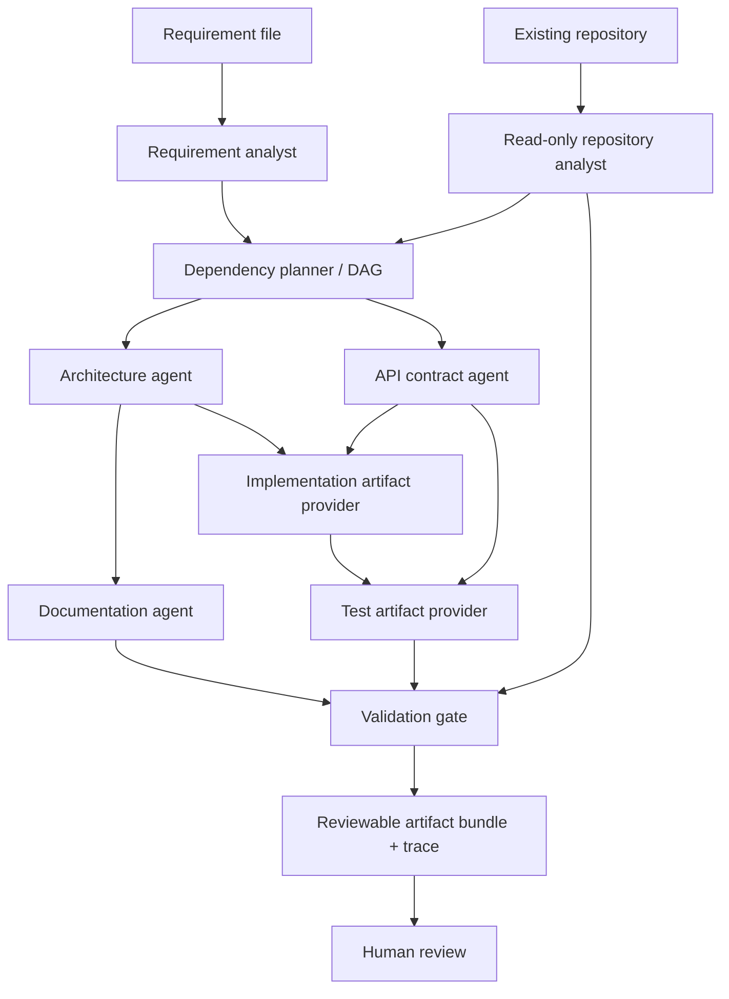

# Agentic Engineering Orchestrator (AEO)

A review-first prototype for an AI Site Reliability / Agentic Engineering assessment. It accepts a software requirement and produces requirement analysis, a read-only repository inventory, an architecture proposal, an OpenAPI contract, operator notes, runnable URL-shortener service files, an execution trace, and a validation report.

**Design stance:** Deterministic orchestration is the default; an optional LLM can help summarize requirements. Planning, dependency management, retries, output handling, and approval state remain deterministic and auditable. The prototype does not deploy software or intentionally run arbitrary shell commands supplied by an LLM.

## What is implemented

- **Multiple specialist agents:** Requirement analyst, read-only repository analyst, architecture agent, API-contract agent, implementation artifact provider, test artifact provider, documentation agent, and validation gate.
- **Dependency-aware DAG:** Independent requirement and repository analysis tasks can run in parallel; later tasks wait for declared dependencies.
- **Bounded recovery:** Tasks receive a bounded number of attempts, with one retry by default. Attempts, durations, statuses, and errors are recorded.
- **Controlled autonomy:** Artifacts are written to the selected output directory. Successful assessments require human review. The optional `--approve` flag records a caller-supplied approval-review request; it does not authenticate approval or authorize deployment.
- **Hybrid LLM support:** Optional OpenAI requirement summarization behind `AEO_USE_LLM=true`. No API key is required in deterministic mode. LLM errors fall back to the original requirement.
- **Runnable URL shortener:** FastAPI + SQLite, with URL creation, redirects, click analytics, input validation, and a health endpoint.
- **Tests and API documentation:** Pytest suite, FastAPI `/docs`, `/openapi.json`, and a human-readable OpenAPI contract.

## Architecture



The implementation provider copies a known, included example service into the output bundle rather than asking an unconstrained model to emit executable code. This makes the demo reproducible.

For a production evolution, this provider could be replaced with a code-generation agent behind the same interface, using isolated worktrees, patch-only writes, static analysis, tests, and explicit approval controls.

## Prerequisites

- Python 3.11 or newer
- Git
- VS Code (recommended)

## Example scenarios

- `examples/url_shortener.md`: Greenfield URL-shortener use case.
- `examples/brownfield_existing_service.md`: Inspects an existing codebase and proposes an incremental change without modifying the target repository. Pass the repository using `--repo path\to\repo`.
- `examples/ambiguous_requirements.md`: Intentionally underspecified requirements for practicing clarification questions and assumption tracking.

Run a scenario by changing `--requirement`. For example:

```bash
python -m aeo.cli \
  --requirement examples/ambiguous_requirements.md \
  --output generated/ambiguous \
  --repo .
```

## Run locally (Windows PowerShell)

Run these commands from the repository root:

```powershell
py -3.11 -m venv .venv
.\.venv\Scripts\Activate.ps1
python -m pip install --upgrade pip
pip install -e ".[dev]"
python -m pytest -v
python -m aeo.cli --requirement examples/url_shortener.md --output generated/demo --repo .
```

If PowerShell blocks activation, run the following in that terminal and activate the environment again:

```powershell
Set-ExecutionPolicy -Scope Process -ExecutionPolicy Bypass
.\.venv\Scripts\Activate.ps1
```

Alternatively, invoke `.venv\Scripts\python.exe` directly.

## Run locally (Git Bash, macOS, or Linux)

Run these commands from the repository root:

```bash
python3 -m venv .venv
source .venv/bin/activate
python -m pip install --upgrade pip
pip install -e '.[dev]'
python -m pytest -v
python -m aeo.cli --requirement examples/url_shortener.md --output generated/demo --repo .
```

For Git Bash on Windows, activate the Windows virtual environment with:

```bash
source .venv/Scripts/activate
```

## Approval workflow

A successful assessment returns `awaiting_human_review` when validation passes. Inspect the generated artifacts, `execution_report.json`, and `execution_trace.md` before making any external approval or deployment decision.

To record that an approval review was requested, pass the optional `--approve` flag:

```bash
python -m aeo.cli \
  --requirement examples/url_shortener.md \
  --output generated/approval-review \
  --repo . \
  --approve
```

**Important:** `--approve` is a caller-supplied workflow signal only. It does not authenticate a human approver, change the assessment status to `approved`, authorize deployment, modify the source repository, or deploy software.

Even when `--approve` is supplied and validation passes, the status remains `awaiting_human_review`. If validation fails, the assessment status is `failed`.

The execution report records the approval and safety boundaries explicitly:

- `approval_requested`: Whether the caller supplied `--approve`.
- `approval_mechanism`: `caller_supplied_flag`.
- `approval_authenticated`: `false`.
- `deployment_authorized`: `false`.
- `deployment_performed`: `false`.
- `repository_modified`: `false`.
- `human_review_required`: `true`.

A production approval workflow would require authenticated identity, authorization checks, and an auditable approval record. These capabilities are not implemented in this prototype.

## Run the URL-shortener API

Run this command from the repository root in a separate terminal:

```bash
uvicorn service.app:app --reload
```

Open the interactive API documentation:

[http://127.0.0.1:8000/docs](http://127.0.0.1:8000/docs)

The OpenAPI JSON schema is available at:

[http://127.0.0.1:8000/openapi.json](http://127.0.0.1:8000/openapi.json)

### PowerShell example

Create a short URL, inspect the redirect, and query analytics:

```powershell
$body = @{
    url = "https://example.com/products?id=42"
} | ConvertTo-Json

$result = Invoke-RestMethod `
    -Method Post `
    -Uri "http://127.0.0.1:8000/api/urls" `
    -ContentType "application/json" `
    -Body $body

$result

Invoke-WebRequest `
    -Uri $result.short_url `
    -MaximumRedirection 0 `
    -ErrorAction SilentlyContinue

Invoke-RestMethod `
    -Uri ("http://127.0.0.1:8000/api/urls/" + $result.code + "/analytics")
```

The redirect request may produce a non-success HTTP response in PowerShell because automatic redirection is disabled. This is intentional so you can inspect the redirect response.

The default database file is `url_shortener.db` in the current working directory. Override its location with the `URL_SHORTENER_DB` environment variable if desired. Tests use a temporary database.

## Optional LLM mode

Deterministic mode is the default. To enable optional requirement summarization, install the LLM dependency:

```bash
pip install -e '.[llm]'
```

Set `AEO_USE_LLM=true`, `OPENAI_API_KEY`, and optionally `AEO_LLM_MODEL` in your shell environment.

Use `.env.example` as a reference; the prototype intentionally does not auto-load `.env`. Never commit real API keys.

If the LLM API is unavailable or summarization fails, the requirement analyst falls back to the original requirement.

The LLM assists with requirement summarization only. It does not control task execution, retries, approval state, or deployment.

## Output artifacts

Depending on the selected scenario and successful execution of the relevant agents, the output directory may contain:

- `requirement_analysis.md` — Requirement interpretation, assumptions, and questions.
- `repository_analysis.md` — Bounded, read-only repository inventory.
- `brownfield_impact_analysis.md` — Requirement-specific impact analysis when produced by the repository analyst.
- `architecture.md` — Component design and production considerations.
- `openapi.yaml` — API contract generated from the current application schema.
- `proposed_api_changes.md` — Proposal-only API changes when requested by the requirement.
- `service/` — Runnable FastAPI URL-shortener service files.
- `tests/test_service.py` — API integration tests.
- `service_README.md` — Generated operator notes.
- `execution_report.json` — Task statuses, attempts, validation results, approval request, and safety flags.
- `execution_trace.md` — Readable task and event trace.

The exact artifact set depends on the selected scenario and successful execution of the relevant agents. A proposed change is not evidence that the corresponding functionality has been implemented.

## Assessment demo script (5–7 minutes)

1. **Requirement interpretation:** Show a requirement file and explain how the analyst records assumptions and unresolved questions.
2. **Orchestration:** Run the orchestrator and show the task DAG, independent tasks, bounded retries, and execution trace.
3. **Artifact review:** Inspect the architecture, API contract, repository inventory, and generated output bundle.
4. **Validation:** Run `python -m pytest -v`, start FastAPI, create a short URL, inspect its redirect, and query click analytics.
5. **Approval boundary:** Show that a successful run awaits human review, even when `--approve` is supplied. Explain why a CLI flag is not authenticated approval.
6. **Brownfield analysis:** Pass `--repo path\to\existing-repo` and show that the scanner inventories files without intentionally executing or modifying the target repository.
7. **Ambiguous requirements:** Demonstrate how the analyst records questions and assumptions rather than silently treating them as confirmed facts.

## Current limitations and trade-offs

- **Requirement analysis:** The baseline analyst uses transparent keyword heuristics. Optional LLM use summarizes the requirement but does not control execution.
- **Repository understanding:** The repository analyst performs a bounded, text-based inventory and heuristic analysis. It does not build complete dependency graphs or deeply understand arbitrary programming languages.
- **Implementation:** The implementation provider copies a known example service rather than generating and applying arbitrary code changes.
- **Validation:** The orchestrator checks required generated artifacts and executes the generated service tests. Validation fails if required artifacts are missing or the tests fail. Test execution has a 120-second timeout but is not isolated in a dedicated sandbox.
- **Approval:** The `--approve` flag is not authenticated human approval. A production workflow would require verified identity, authorization policy, and an auditable approval record.
- **Production readiness:** Passing the current validation gate does not prove security, performance, reliability, or deployment safety.
- **Database:** SQLite is suitable for a local demo, not a high-scale, globally distributed production service.
- **Security and operations:** Authentication, rate limiting, bot filtering, URL reputation checks, retention policy, deployment, and load testing are not implemented.

These limitations are intentional and documented. A credible assessment should distinguish what is implemented from the production roadmap.

## License

MIT. See `LICENSE`.
